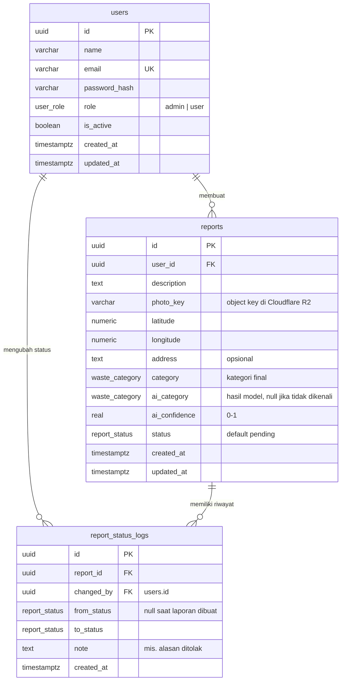

# ERD – Smart Waste Management System

Database: PostgreSQL. Versi DBML untuk [dbdiagram.io](https://dbdiagram.io) ada di [`schema.dbml`](schema.dbml).

## Enum

| Enum | Nilai |
|---|---|
| `user_role` | `admin`, `user` |
| `report_status` | `pending`, `in_progress`, `completed`, `rejected` |
| `waste_category` | `glass`, `metal`, `organic`, `paper`, `plastic`, `textile` |

Nilai `waste_category` sama dengan urutan kelas model di `ml/models/labels.json`.

## Tabel

### `users`
Akun admin dan warga. Role menentukan menu dan endpoint yang bisa diakses. Akun tidak dihapus permanen, cukup dinonaktifkan lewat `is_active` supaya laporan lamanya tetap punya pemilik.

### `reports`
Laporan sampah dari warga.

| Kolom | Keterangan |
|---|---|
| `photo_key` | Key file di R2, bukan URL lengkap. URL dibentuk backend, jadi domain storage bisa diganti tanpa mengubah data. |
| `latitude`, `longitude` | `numeric(9,6)`, presisi sekitar 10 cm. |
| `ai_category`, `ai_confidence` | Hasil model saat laporan dibuat. `ai_category` bernilai null jika confidence di bawah ambang batas ("tidak dikenali"). |
| `category` | Kategori final: hasil AI yang diterima pengguna, atau pilihan manual pengguna. Admin juga bisa mengoreksinya. |
| `status` | Status terkini, disalin dari log terakhir supaya filter dan statistik dashboard cukup membaca satu tabel. |

Kolom AI dan kolom final dipisah supaya akurasi model di dunia nyata bisa diukur: bandingkan `ai_category` dengan `category`.

### `report_status_logs`
Riwayat perubahan status. Satu baris dibuat saat laporan dikirim (`from_status` null, `to_status` pending) dan setiap kali admin mengubah status. Dipakai untuk timeline di detail laporan (mobile dan web) dan untuk menyimpan alasan penolakan di `note`.

## Relasi

| Relasi | Kardinalitas | On delete |
|---|---|---|
| `users` → `reports` | 1 : N | `restrict` |
| `reports` → `report_status_logs` | 1 : N | `cascade` |
| `users` → `report_status_logs` (`changed_by`) | 1 : N | `restrict` |

## Index

| Tabel | Kolom | Untuk |
|---|---|---|
| `users` | `email` (unique) | Login |
| `reports` | `user_id` | Riwayat laporan milik user |
| `reports` | `status` | Filter status, statistik per status |
| `reports` | `created_at` | Urutan terbaru, tren harian |
| `reports` | `category` | Statistik per kategori |
| `report_status_logs` | `report_id` | Timeline status satu laporan |
